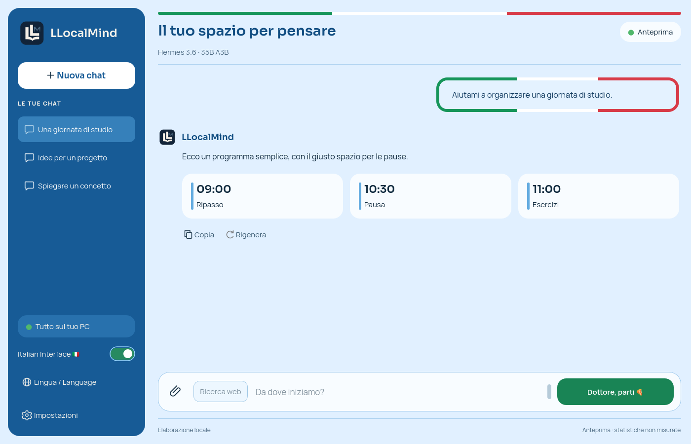

# LLocalMind

Local AI chat made in Italy 🇮🇹 for Windows and Intel PCs, with GGUF models,
image input and optional web research. Models are not included.

**Project goal:** make models larger than those normally recommended for a
PC’s available hardware practical to run locally. Quantization, selective MoE
expert activation and SSD-backed weight loading help reduce RAM pressure,
so the whole model does not have to stay in physical memory at once.

## Install and update

1. Download the installer from **[GitHub Releases](https://github.com/vin10122/LLocalMind/releases/latest)** and run it.
2. Open **Settings / Impostazioni**, select your compatible GGUF and save.
3. Wait for **Ready / Pronto**, then send a message.

The installer includes Python and dependencies. Updates are available under
**Settings → Check for updates**, including public previews. You can also run
a newer installer over the existing installation: chats, settings and external
models are preserved. No uninstall or model download is needed.

For the portable edition, extract the **entire ZIP** and open
`LLocalMind\LLocalMind.exe`; keep its supporting files together. To update,
replace the application folder with the newly extracted version.

Requires **64-bit Windows 10/11**, a compatible model and enough free RAM.
The tested PC has an **Intel Core Ultra 5 226V, Arc 130V and 15.7 GiB RAM**.
Use current Intel drivers and AC power for best performance. For text mode,
select CPU for DeltaNet and attention if the Intel GPU is unavailable.

**AMD Ryzen:** CPU mode should also work on modern Ryzen processors supporting
AVX2, FMA and F16C. Set **DeltaNet → CPU** and **Full attention → CPU**;
Intel GPU/NPU acceleration does not apply to AMD hardware. AMD-specific testing
and benchmark data are still insufficient to confirm broad compatibility or
provide reliable performance figures.

## Features

- **Text chat:** local inference with saved conversations, streaming, Copy,
  Regenerate, Stop and per-answer token counts/speed.
- **Images:** select the local Vision engine, click **Install / update CPU
  vision runtime**, choose a compatible **mmproj** alongside your language
  GGUF, then attach an image. The encoder and language model run on CPU.
  Image history is kept with the chat. Matching filenames alone do not prove
  model/projector compatibility.
  In Vision mode choose **Fast / Rapida** for overviews or **Detailed /
  Dettagliata** for small text and documents. Fast limits transmitted image
  pixels without reloading the model; it can lose fine details. Originals and
  conversation history are preserved. Detailed remains the default.
- **English / Italian:** use the separate **Lingua / Language** button or the
  language selector in Settings. English mode guides new answers in English;
  existing messages keep their original text.
- **Italian Interface 🇮🇹:** a separate switch enables azure colours, a
  tricolour top bar and thick tricolour prompt borders. The large controls read
  **Dottore, parti 🍕** and **Fratello, fermati 🍝**. This saved appearance
  preference does not change language or inference.
- **Web research:** optional and off by default, available in text mode.
  It sends only the current question to **Tavily's free keyless API** and uses
  up to three returned HTTPS sources; model generation stays local. No account,
  API key or paid fallback is used. **Free usage is limited**: when unavailable
  or capped, search stops with an error. It remains experimental; check sources
  and dates. Older chats retain their original DuckDuckGo label; regenerating
  a web answer uses Tavily.



## Performance and limits

Recent user-reported runs with Hermes 3.6 35B A3B on the PC above, on AC power,
show roughly **6–8 tok/s**, or **4–5 tok/s with a cold cache**. Warm-cache peaks
can be substantially higher. These observations are not guaranteed rates;
model, context, available RAM, temperature and execution engine affect results.

Generation tok/s exclude the wait for the first token. **Text prefill has been
negligible in recent local use; image prefill is still being measured for more
precise figures and can take much longer.** Large models and vision encoders
can put substantial pressure on a 16 GiB system.

This is a work in progress. Check important answers; component tests do not
guarantee general answer quality. Windows installers are currently unsigned.

## Your data

Settings and chats: `%LOCALAPPDATA%\LLocalMind\data`.
Logs and timing reports: `%LOCALAPPDATA%\LLocalMind\logs`.
Models remain at the paths you select. Back up the whole data directory to
preserve chats and their image attachments.

## From source

```powershell
git clone https://github.com/vin10122/LLocalMind.git
cd LLocalMind
py -3.14 -m pip install -r requirements-gui.txt
py -3.14 gui.py
```

CLI: `py -3.14 chat.py default`; exit with `/exit`.
Use `--language en` for English response mode.
For native-kernel setup and builds, see [Development](docs/development.md).
All development tests, benchmarks and probes are in [test/](test/README.md).

## Inspiration

LLocalMind was inspired by **Flash-MoE**, as shown in
[this Instagram Reel](https://www.instagram.com/reel/DdqjqtAxAk6/).
It is an independent project, not affiliated with or endorsed by Apple.

## License

Code: [Apache 2.0](LICENSE). Models and external runtimes have their own licenses.
