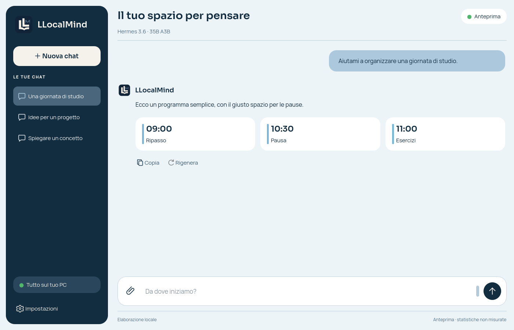

# LLocalMind

**An experimental project made in Italy 🇮🇹 for running MoE language models locally on Intel
hardware with OpenVINO.**

This project explores splitting inference work between the CPU and integrated
graphics, while loading only some of the model weights from disk at a time.
The goal is to explore what may be possible on a regular PC without a
high-memory discrete graphics card.

> **Status: work in progress.** The program has generated answers to real
> prompts, but speed, answer quality, and stability still need more testing.
> Expect long wait times, changes, and possible issues.

**[Install](#install-on-windows) · [Update](#update-llocalmind) · [Desktop app](#llocalmind-desktop-app) · [Results](#status-and-results)**

## Install on Windows

The latest stable Windows release is [v0.2.1 – International](https://github.com/vin10122/LLocalMind/releases/tag/v0.2.1):

### Recommended: Windows installer

1. Download **[LLocalMind-Setup-0.2.1-windows-x64.exe](https://github.com/vin10122/LLocalMind/releases/download/v0.2.1/LLocalMind-Setup-0.2.1-windows-x64.exe)**.
2. Run the installer, then open **LLocalMind** from the Start menu.
3. Open **Impostazioni → Sfoglia**, select your compatible local **GGUF** file,
   and save. Wait for the model status to become **Pronto**, then send a message.

**No Python installation, Visual Studio or DLL compilation is needed.** The
installer includes the application runtime, OpenVINO, fonts and native kernels.
The application is installed for your Windows user. Keep the GGUF in a separate
model folder or on another drive; the app remembers the path you selected.

Use 64-bit Windows 10/11 and current Intel drivers for the GPU/NPU. The default
configuration uses CPU experts and GPU projections. If the GPU is unavailable,
select CPU for DeltaNet and Full attention under advanced settings.

### Portable version

1. Download **[LLocalMind-0.2.1-windows-x64-portable.zip](https://github.com/vin10122/LLocalMind/releases/download/v0.2.1/LLocalMind-0.2.1-windows-x64-portable.zip)**.
2. Extract the **whole ZIP**, then open `LLocalMind\LLocalMind.exe`.
3. Select the GGUF in settings as described above.

Keep the `_internal` directory and the other bundled files beside the EXE;
copying only `LLocalMind.exe` will not work. The portable version also includes
Python and the libraries, so it requires no Python setup.

GGUF model files are **not included**. This release passed GUI, CPU OpenVINO,
native-kernel and installer startup checks on Windows; full-model quality,
Intel GPU/NPU support and performance still need testing on the target PC.
SHA-256 sidecars are attached to the release; the release is not code-signed.

## Update LLocalMind

### Installed app: update without uninstalling

For a newer **published release, including previews**, open **Impostazioni → Controlla aggiornamenti**,
choose the download, then confirm installation. LLocalMind verifies the
installer's SHA-256, saves the conversation, closes the model and exits. The
installer updates the same application and reopens it when complete.

**v0.2.1 – International is the current stable release.** Since v0.1.5,
the updater includes public prereleases and selects the highest newer numeric
`MAJOR.MINOR.PATCH` version among the most recent 100 releases. Drafts, equal
versions and downgrades are excluded. Preview updates are labelled **anteprima**.
Installer origin and SHA-256 verification remain enforced.

**Users of v0.1.3 and earlier must run this installer manually once**:
the old updater checks stable releases only and cannot discover newer releases.
Download the new setup EXE from [Releases](https://github.com/vin10122/LLocalMind/releases),
close LLocalMind and run it over the existing installation. **Do not uninstall
first.** Settings, conversations, installed vision runtime and external GGUFs
are preserved; models do not need downloading again.

If you installed a preview before the repository was renamed to
`vin10122/LLocalMind`, run the new installer manually once to refresh the
updater's repository address as well.

### Portable app: replace the application folder

Close LLocalMind, download the newer portable ZIP and extract it into a **new
folder**. Open the new `LLocalMind.exe`. Settings and conversations are stored
outside the portable folder and will be reused by the same Windows user.
Keep the previous folder until you have checked that the new version works.

The in-app updater downloads an **installer**, not a portable ZIP. To remain
portable, use the ZIP procedure above; accepting the in-app installer creates
the normal installed application instead of updating the portable folder.

### Source checkout: update through Git

From PowerShell in the repository folder:

```powershell
git pull --ff-only origin master
py -3.14 -m pip install -r requirements-gui.txt
```

If the update changes native C++ code, close the app and rebuild the kernels
before launching it:

```powershell
.\scripts\compile_dequant_k.bat
.\scripts\compile_native_expert.bat
```

Then launch the GUI:

```powershell
py -3.14 gui.py
```

Rebuilding is not necessary merely because you reopened PowerShell. The
GUI updater does not update a Git checkout. For a CLI-only checkout, use
`requirements.txt` and launch `py -3.14 chat.py default` instead.

### Where your files are stored

| Files | Location |
|---|---|
| Installed program | `%LOCALAPPDATA%\Programs\LLocalMind` |
| Settings and conversations | `%LOCALAPPDATA%\LLocalMind\data` |
| Downloaded updates | `%LOCALAPPDATA%\LLocalMind\updates` |
| Packaged-app logs | `%LOCALAPPDATA%\LLocalMind\logs` |
| GGUF models | The external path you choose in settings |

Application updates replace program files separately from user data and models.

## Inspiration

This project was inspired by Apple's **Flash-MoE** app, as seen in
[this Instagram Reel](https://www.instagram.com/reel/DdqjqtAxAk6/). It is an
independent software project and is not affiliated with, endorsed by, or
sponsored by Apple.

## At a glance

- Reads models in GGUF format and lets you chat through the desktop GUI or PowerShell.
- Optional DuckDuckGo web research can pass up to three public HTTPS pages to the local model.
- Uses OpenVINO to run calculations on the CPU or a supported Intel device.
- The model uses a **Mixture of Experts (MoE)** architecture: for each step,
  it activates only some groups of model weights, called *experts*, rather
  than all of them.
- The command-line interface reports prompt processing time and generation
  speed separately.

## Status and results

The current test model is **Hermes 3.6 35B A3B** in GGUF format. Model files
are external and are not included in the application.

Recent user-reported desktop runs on an **Intel Core Ultra 5 226V, integrated
Arc 130V and 15.7 GiB usable RAM**, on Windows **with the AC adapter connected**,
show approximately **6–8 tok/s during generation**, or around **4–5 tok/s
with a cold cache**. With a warm cache, **peaks can rise substantially above
these ranges**. Peak speed is variable and should not be confused with the
average speed of a complete answer or a guaranteed sustained rate.

These are approximate observations from local use, not a controlled benchmark
or a rate guaranteed on other PCs, models, contexts or execution engines.
Warm-up, OS file cache, expert routing, available RAM, drivers, power mode and
temperature affect the result. They do not isolate the effect of any single optimization. Keep AC power and performance settings consistent when
comparing runs, and report cold-cache and warm-cache results separately.

**Generation speed excludes prefill and the wait for the first token.** In
recent local use, text-only prefill has been negligible relative to the overall
interaction. This is an observation, not a guarantee for arbitrary long inputs.
Image prefill is still being measured to obtain more precise figures; image
encoding and prompt processing can take much longer than generation.
Use the per-response metrics and local performance reports to measure these
phases separately; a one-token response does not measure decode throughput.
The native Intel/OpenVINO text engine and the llama.cpp vision engine are
separate execution paths, so their rates should be compared under matching
conditions rather than treated as interchangeable.

### Execution paths and validation

The optimized text path uses native quantized CPU decode with four expert
workers, OpenVINO expert prefill with four CPU threads, GPU projections,
native FP32 DeltaNet decode recurrence, an eight-expert sliding prefetch
window and router weights converted to FP32 once per layer. Default raw
expert cache: **320**; converted weight cache: **1**. Grouped attention avoids
replicating KV heads; compatible KV storage is reused across requests.
Shared-expert prefill uses bounded matrix batches for inputs of at least
16 tokens, including long prompts. The default BLAS thread count is **1**;
OpenVINO's explicit thread settings are separate.

The vision path uses llama.cpp, with both the language model and image encoder
on CPU. See [image input](#image-input-v013-and-newer) for runtime installation
and configuration.

Automated tests validate components, numerical comparisons, GUI behavior,
process cleanup and Windows packaging. They do not establish general
answer-quality parity or a full-model performance guarantee. See the
[performance audit](docs/performance-audit.md) for implementation details,
remaining bottlenecks and measurement limits.

### Check sustained generation from source

Save the complete input as a UTF-8 file and run:

```powershell
py -3.14 chat.py default --prompt-file .\input.txt --max-tokens 512 --max-seq 2048 --native-decode native
```

For per-window decode timings:

```powershell
py -3.14 tools\bench_stability.py --prompt-file .\input.txt default --native-decode native --max-tokens 512 --max-seq 2048
```

The benchmark reports 64-step windows, median and p95 decode latency,
excluding the first token from prefill. Partial final windows are identified.
The output limit does not force generation past EOS; the input and output
budget must fit the configured context. These commands test the native text
path; use the vision benchmark documented below for image requests.

## LLocalMind desktop app

The **LLocalMind** Qt desktop interface follows the approved rounded blue
design, with the LL/M logo and bundled Sora/Manrope fonts. It includes saved
conversations, multi-turn context, streaming answers, Copy, Regenerate, Stop,
local text-file attachment and model/settings selection. User data is stored
outside the program directory. The existing PowerShell chat remains available.

### Italian and English mode (0.2.1 – International)

Use the separate **Lingua / Language** button in the sidebar to choose
**Italiano** or **English**. The same choice is available in **Impostazioni /
Settings → Interface language**. It is saved for the next launch and takes
effect without reloading the model. While loading or generating, finish or stop
the operation before changing language.

English mode translates navigation, settings, dialogs, status messages and
response metrics, and guides new text/vision answers in English unless you
explicitly request another language. Existing messages, chat titles, attachments
and model files keep their original content. Switching languages can invalidate
the next prompt's cached prefix because the system instructions change.

From source, launch the English GUI with `py -3.14 gui.py --language en`, or use
English response mode in the CLI:

```powershell
py -3.14 chat.py default --language en "Explain how this works."
```

### Optional web research (v0.2.0)

**Web research is still experimental and may cause problems:** requests can
fail, providers may block or throttle access, and results may be incomplete or
unreliable. Check important claims against the linked sources.

The **Ricerca web / Web search** control is off by default. When enabled for a text-model
turn, LLocalMind sends that question to DuckDuckGo, reads up to the first three
usable public HTTPS results, and gives bounded text excerpts and their URLs to
the local model. The answer is generated locally; the search query and page
requests do leave the PC. No cookies or local files are sent. External page
text is treated as untrusted evidence, not as instructions. Search is not
available in the separate Vision engine.

In the CLI, opt in per run with `--web-search`:

```powershell
py -3.14 chat.py default --web-search "Quali sono le novità recenti?"
```

### Image input (v0.1.3 and newer)

The optimized Intel/OpenVINO engine is **text-only**. The former experimental
RGB-average projector has been removed: it did not execute the trained vision
tower and its output was not passed to the model. Native OpenVINO vision is
not implemented. Image requests now use a separate **local llama.cpp
engine**, which runs the supported model's actual vision tower, projector and
multimodal prefill. The language model and image encoder run on CPU in the
stable release. Text-engine token rates do not apply to this path.

You need your language-model GGUF, its **compatible mmproj GGUF**, and a
llama.cpp runtime that supports that model architecture. **Since v0.1.5 the
Windows x64 app can install the runtime automatically.** Models and projectors
remain external and are not downloaded by the runtime installer.
Compatibility of the Hermes Final/APEX GGUF with the projector from the MTP
repository remains unverified; a similar filename alone is not a guarantee.

In the desktop app, open **Impostazioni**, select **Testo e immagini · llama.cpp locale**, then click **Installa / aggiorna motore vision CPU**. Wait for the download and verification;
the executable path is saved automatically, and settings reopen with your
unfinished selections preserved. Choose the matching mmproj. Select the normal
language-model GGUF in the model field. Save and wait for **Pronto**; the
previous engine is closed before the vision engine loads, avoiding two loaded
language models. Use the paperclip to attach PNG, JPEG or WebP files and send
your question. Sending an image alone uses a default description request.
Image previews and references are retained in the saved conversation and used
in subsequent turns and regenerated answers. To resume the optimized text
engine, select **Testo · Intel ottimizzato** and start a text-only chat.


The button installs the official **llama.cpp b12110 Windows CPU x64** package
under `%LOCALAPPDATA%\LLocalMind\runtimes\llama.cpp`. It requires no administrator
rights and verifies a SHA-256 pinned in the application before extraction.
The executable and all its DLLs are kept together and tested with `--version`.
A verified installation can be reused offline. Failed or cancelled attempts
remove staging files and leave the previously selected engine unchanged.
Repairs/new runtime versions install beside existing files, avoiding replacement
of DLLs that may be in use. App updates preserve this external runtime folder;
old runtime copies are not automatically deleted.

You can still select a manually installed executable with **Sfoglia…**. For
manual installation, extract the entire official
[Windows CPU x64 ZIP](https://github.com/ggml-org/llama.cpp/releases), keeping DLLs
beside `llama-server.exe`. Automatic installation is limited to Windows x64;
other source platforms require an appropriate local executable. llama.cpp is
provided separately by its authors under the
[MIT license](https://github.com/ggml-org/llama.cpp/blob/master/LICENSE).

For a CLI test, set `FLASH_MOE_GGUF` to your language-model file, then use your
actual executable, projector and image paths:

```powershell
py -3.14 chat.py default --llama-server "C:\llama.cpp\llama-server.exe" --mmproj "D:\models\mmproj-model-F16.gguf" --image "C:\Users\valer\Pictures\foto.jpg" "Descrivi questa immagine."
```

This branch runs before native-model allocation. Without `--mmproj`, `--image`
is rejected. `--llama-server` may be omitted if the executable is on `PATH`.
In interactive CLI mode, the image supplied at launch accompanies each
independent question; `/exit` exits. GUI conversations retain multi-turn history.

The server binds to `127.0.0.1`, uses a random API key and is closed with the
app or on engine changes. Images go to that process as PNG pixel data; no cloud
vision service is used. GUI **Stop** also interrupts the request before the
first token. Diagnostics are in `%LOCALAPPDATA%\LLocalMind\logs\vision.log`.
Response tok/s use server token counts and decode timings; when timings are
absent, the GUI reports that the rate is unavailable. Network chunks are never
counted as tokens. Interrupted requests may omit final metrics.

Up to four images per GUI message are accepted, at most 20 MiB and 32 megapixels
per input. Image orientation is applied, transparency is composited on white,
metadata is removed and the longest edge is reduced to 2048 pixels without
upscaling. This can lose fine text/details. Copies live in the user data folder
under `data/images`; back it up with `conversations.json`. Deleting chats
currently leaves those image copies; automatic cleanup is not implemented.

Visual tokens consume context too. If the server reports a context limit,
increase context only if RAM permits. On 16 GiB systems the large Hermes model
plus its vision encoder may page heavily. **Real image-answer quality, Windows
vision startup, compatibility and performance with the exact Hermes/mmproj
still require target-PC validation.** Automated tests cover transport, pixels,
history, cleanup and cancellation using a test server, not a trained model.

### CPU-only image encoder

The stable release runs both the vision encoder and language model on CPU.
GPU image-encoder offload is not supported. The installer uses a pinned,
SHA-256-verified official llama.cpp Windows CPU runtime; an app update does
not delete older external runtime files. Users upgrading from a preview can
click **Installa / aggiorna motore vision CPU** to select the CPU runtime.

The generation ranges above do not describe image-prefill latency. The
performance report records `encoder_device` alongside prompt/cache counts and
timings. Compare the same image and history, on AC power, before attributing
a change in first-token latency to a particular configuration.

### Vision performance controls

The CPU profile limits each image to **768 visual tokens**, uses batch 2048 /
microbatch 1024 and caps the prompt-cache allowance at 128 MiB. Vision uses
eight CPU threads by default. These settings are available under advanced
options. On a Core Ultra 5 226V, a local test with one 768-token image measured
about **92 s** to the first token (808 prompt tokens); the earlier 4-thread,
512/256 profile had reached 76 prompt tokens in 29 s before cancellation, so
these are not a controlled end-to-end comparison. Reducing visual tokens
can speed image processing but lose fine details or small text. Warm-up stays
enabled; disabling it moves some startup work to the first request.

Image payloads and matching prompt prefixes are reused where possible. Startup
no longer imports the native OpenVINO stack for vision, and irrelevant settings
no longer reload the model. Native text prefill also batches shared experts on
long inputs, and reuses compatible KV storage between requests.

**The language model and image encoder run on CPU.** The 35B model plus
encoder can still exceed the practical RAM budget on a 16 GiB PC. See the
[performance audit](docs/performance-audit.md) for findings, tradeoffs and
the limits of the available measurements.

Latest load/request reports are written automatically to
`%LOCALAPPDATA%\LLocalMind\logs\performance-load.json` and
`performance-request.json`, without prompts or images. To measure startup and
two image requests using your saved settings, **close the GUI first**, then run:

```powershell
& "$env:LOCALAPPDATA\Programs\LLocalMind\LLocalMind-Diagnostics.exe" --benchmark-vision --image "C:\path\image.jpg"
```

For portable installs, use the diagnostics EXE beside the app. From source:
`py -3.14 tools\bench_vision.py --image "C:\path\image.jpg"`.
The report is saved to `%LOCALAPPDATA%\LLocalMind\logs\vision-benchmark.json`.
The second identical request may benefit from warm-up/prefix caching; compare
first-token latency and prefill as well as decode tok/s.



To run the GUI **from source**, install its dependencies once, then open it
(installer and portable users can skip this step):

```powershell
py -3.14 -m pip install -r requirements-gui.txt
py -3.14 gui.py
```

Select a GGUF in **Impostazioni → Sfoglia**. The app remembers the selection
and loads it on subsequent starts. The measured CPU expert / GPU projection
defaults are preselected; advanced settings expose cache, worker, context and
output limits. Stop is cooperative: during a long prefill, cancellation or
closing the window waits for the next token boundary before releasing the
model. Increasing conversation history also increases prompt processing work.

To view the design without importing the inference runtime or reading a GGUF:

```powershell
py -3.14 gui.py --demo
```

The preview uses temporary conversations and labels its status as an
**anteprima**; it reports no fabricated live performance. Normal sessions
display measured effective decode speed and time to the first token.

Each generated answer also shows **tok/s and token count below that answer**.
These measurements are saved with the conversation and restored when it is
reopened. The rate excludes prompt processing and the first token's sampling;
a one-token answer is marked as unmeasurable. Older answers with no recorded
measurements do not receive estimated numbers. Regenerating an answer replaces
its measurements; interrupted answers retain their available measured stats.

### Windows EXE builds (developers)

GitHub Actions builds Windows downloads on pushes to `master` and matching
`vMAJOR.MINOR.PATCH` tags. Each build compiles the kernels, runs source tests,
then smoke-tests both the portable EXE and an installed copy without a GGUF.
The run's `LLocalMind-Windows-x64` artifact contains an installer, portable
ZIP and SHA-256 sidecars. Tagged builds also publish a **preview release**
after all checks pass. Since v0.1.5, public previews are offered by the updater
as well; maintainers can still promote a release after target-PC validation.

The build definition bundles Python, OpenVINO, the native kernels, icons and
fonts into a portable application folder. GGUFs stay external. On Windows:

```powershell
py -3.14 -m pip install -r requirements-build.txt
.\scripts\compile_dequant_k.bat
.\scripts\compile_native_expert.bat
powershell.exe -NoProfile -ExecutionPolicy Bypass -File .\scripts\build_desktop.ps1
```

The executable is `dist\LLocalMind\LLocalMind.exe`; distribute the **whole
LLocalMind folder**, not just the EXE. With Inno Setup 6.3+ installed, add
`-Installer` to the build script to also create the per-user setup EXE and
its checksum. GitHub Actions verifies both packaged and installed startup on
Windows, including a CPU OpenVINO graph and native kernels. Full-GGUF GUI
performance and Intel GPU/NPU driver behavior still need validation on the
target PC. The Windows EXE is built on a Windows runner, not cross-compiled
by the Linux tests.

**Impostazioni → Controlla aggiornamenti** checks public GitHub releases, including previews,
downloads with SHA-256 verification and, in the frozen Windows app, offers
installation after saving chats and closing inference resources. Program files
are replaced independently of conversations and external models. Source mode
can download the installer but does not install over a Git checkout.

From a source checkout, `py -3.14 update.py check` checks for a newer published
application release, including previews, without loading the model. This does not replace `git pull`
for source updates. See [Windows packaging and updates](packaging/windows/README.md)
for release assets, checksum verification and installer details.

## Source requirements

The following requirements are for running or building from a source checkout.
The installer and portable downloads already include Python and the libraries.

- 64-bit Windows 10 or 11.
- Python 3.14 and the packages listed in `requirements.txt` for the CLI,
  `requirements-gui.txt` for the desktop GUI, or `requirements-build.txt`
  for packaging. Windows release builds use Python 3.14 x64 and bundle it.
- A compatible GGUF model file. The model used in testing is described
  below.
- Up-to-date Intel drivers if you want to use integrated graphics.

From PowerShell, in the project directory, install the dependencies with:

```powershell
py -3.14 -m pip install -r requirements.txt
```

If the `py` command is not available, use `python` instead.

## Set up the model

For the desktop GUI, select the GGUF in settings. The following discovery and
environment-variable instructions apply to the command-line client.

If the GGUF file is in the project directory, the program will try to find it
automatically. Otherwise, set its path before starting the chat:

```powershell
$env:FLASH_MOE_GGUF = "D:\models\model.gguf"
```

This project **does not distribute the model**. Obtain it from an authorized
source and check the terms provided by its author. The model's license and
the code's license are separate.

### Source and attribution for the tested model

The closest public match to the filename used in testing is
[`LuffyTheFox/Qwen3.6-35B-A3B-Uncensored-Genesis-Hermes-GGUF`](https://huggingface.co/LuffyTheFox/Qwen3.6-35B-A3B-Uncensored-Genesis-Hermes-GGUF).
Its model card describes it as based on
[`HauhauCS/Qwen3.6-35B-A3B-Uncensored-HauhauCS-Aggressive`](https://huggingface.co/HauhauCS/Qwen3.6-35B-A3B-Uncensored-HauhauCS-Aggressive),
with a Hermes contribution attributed to
[`DJLougen`](https://huggingface.co/DJLougen/hermes-qwen3.5-35b-a3b-GGUF).
The LuffyTheFox and HauhauCS model cards declare Apache-2.0 for their
respective repositories.

The file used in testing is named
`Hermes3.6-35B-A3B-Uncensored-Genesis-Final-APEX-Compact.gguf`, while the
corresponding variant listed in the LuffyTheFox repository omits `Final`
from its name. The match is likely, but this alone does not confirm that
both files are the same revision or contain the same weights. The model is
excluded from this project repository; before using or redistributing it,
verify the source and terms for the exact file you obtained.

## Start a chat

```powershell
py -3.14 chat.py default
```

Enter a prompt after the `>` symbol. To exit, type `/exit` or press
`Ctrl+C`.

To explicitly enable DuckDuckGo research for a CLI prompt, add `--web-search`.
This sends the query to DuckDuckGo and retrieves up to three public HTTPS
pages; without the flag, the CLI makes no web requests.

The preset runs the main model on the CPU and uses the Intel GPU for DeltaNet
projections and full attention. If the GPU or its driver is unavailable, use
`--ssm-device CPU --attention-device CPU` instead, including after `default`.

The `default` preset selects CPU for the main device, GPU for DeltaNet and
full-attention projections, cache sizes of 320 and 1, deterministic
sampling, and a 512-token maximum. It uses native expert decode automatically
when the CPU and compiled DLL support it; otherwise it reports an OpenVINO
fallback. Explicit command-line flags override the preset. Append a prompt after `default` for a
one-shot run.

The assistant is instructed to give clear, complete answers and explain
important details, while keeping simple answers direct and avoiding filler.
`--max-tokens` is a **maximum limit**, not a required answer length: generation
stops earlier if the model emits its end-of-response token. If it reaches the
limit, the answer may be incomplete; in that case, raise the limit further.
The default answer limit is 512 tokens; existing settings using the old
128-token default are raised to 512 (or the available context limit), while
other explicitly chosen limits are preserved.

After each answer, the program reports generated tokens per second, prompt
processing time, and some cache statistics. Initial model loading may take
a long time. Logical read bytes and cache counters in the footer are
cumulative for the process; they do not measure physical SSD traffic. Each
question currently starts a fresh model context, retaining reusable caches.

### Useful options

- `--device CPU`, `GPU`, or `NPU`: selects the main OpenVINO device.
  Availability depends on your hardware and drivers.
- `--max-tokens 512`: sets the maximum number of tokens to generate per
  answer.
- `--cache 320`: limits how many quantized expert weight groups to keep in
  memory.
- `--weight-cache 1`: limits how many converted expert weight groups to
  keep in memory. The recommended value is 1 for the measured native-decode
  configuration; larger values can consume substantial RAM.
- `--temp 0`: uses deterministic token selection; higher values introduce
  more variation.
- `--max-seq 512`: sets the maximum supported context length. For a larger
  context, for example use `--max-seq 2048 --max-tokens 512`. This increases
  context capacity; it does not force the model to generate 512 tokens.

## Build the native decode kernel

Install Visual Studio Build Tools with the x64 C++ tools, then run from
PowerShell in the project root:

```powershell
scripts\compile_dequant_k.bat
scripts\compile_native_expert.bat
py -3.14 chat.py default --native-decode native
```

After updating the C++ sources, close running chats and rebuild with
`scripts\compile_native_expert.bat`; a DLL built before this update does not
contain the latest fused Q6_K code (and older builds may lack the Q3_K
optimization or DeltaNet entry point). Recompilation is not
needed merely because you reopened PowerShell. Startup reports whether the
native DeltaNet entry point is present; older DLLs retain NumPy recurrence.

The first DLL accelerates weight conversion during prefill. The second
(`src/flash_moe/moe_quant_dot.dll`) reads quantized expert weights directly
during single-token decode, avoiding full FP16 expert materialization. It
requires AVX2, FMA and F16C and supports Q8_0, Q3_K, Q4_K, Q5_K and Q6_K.
The same native DLL also contains the FP32 DeltaNet recurrence kernel.
The build does not replace the weight-conversion DLL. Binaries and model
files are excluded from Git; each Windows installation builds its own DLLs.

`--native-decode native` requires the kernel and reports an error if it
cannot be used. The default `auto` falls back to OpenVINO if unavailable;
`--native-decode openvino` explicitly selects the reference expert path.
The prefill uses OpenVINO in all three modes. `--expert-workers 4` and
`--prefill-threads 4` expose the measured thread settings for other PCs.

## Optional C++ weight-conversion acceleration

On Windows, you can compile the C++ module used to convert some weight
formats:

```powershell
scripts\compile_dequant_k.bat
```

This requires Visual Studio Build Tools with the x64 C++ compiler. The
generated file is not included in the repository. If the DLL is unavailable,
the program uses a Python-based fallback, which may be slower but does not
require the DLL.

## Run some checks

Tests are Python scripts. For example, run these from the project root:

```powershell
py -3.14 tools\test_long_context.py
py -3.14 tools\test_optimized_inference.py
py -3.14 tools\test_attention.py
py -3.14 tools\test_gated_deltanet_real.py
```

Some tests require the configured GGUF model and may take a long time. The
second test uses the configured model; set it up as described above first.
These checks cover individual components and do not replace a full chat
test.

Scripts that compare results with `llama.cpp` dumps look for
`lcpp_eval.txt` in the project directory by default. To use a dump elsewhere,
set `FLASH_MOE_LCPP_EVAL` to its path before running the script.

## Current limitations

- Testing has mainly been done on one Intel PC; performance and compatibility
  may differ on other hardware.
- Generation is slow compared with online services and systems with a
  discrete GPU.
- Performance depends heavily on model-file access and available memory.
- The assistant is prompted to give complete answers, but model behavior
  varies; the 512-token default limit can still cut off a long answer.
- This is not yet ready for production use.

## Code license

The code in this repository is distributed under the
[Apache-2.0 license](./LICENSE). This license applies to the project code,
not to external model weights or data.
